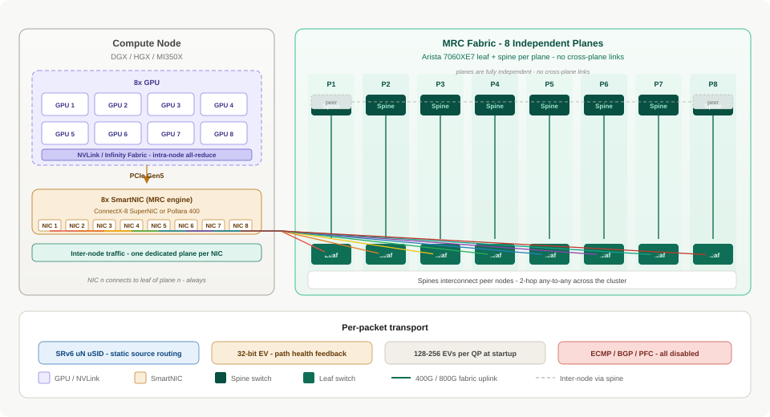

# Multiplanar Fabric AI Networking Primer

Reference architecture and design diagrams for **MRC (Multipath Reliable Connection)** networking — the OCP-standard approach to scaling AI training clusters over deterministic, multi-plane Ethernet fabrics.

MRC replaces traditional InfiniBand-style fat-tree designs with **eight fully independent fabric planes**, static SRv6 source routing, and NIC-driven path selection. The result is predictable, high-bandwidth inter-node communication for distributed training workloads without ECMP, dynamic routing, or application changes.

---

## What is MRC?

**Multipath Reliable Connection (MRC)** is defined in [OCP MRC Rev 1.0](https://www.opencompute.org/documents/ocp-mrc-1-0-pdf) and targets large-scale GPU clusters where collective operations (all-reduce, all-gather) dominate inter-node traffic.

| Principle | Description |
|-----------|-------------|
| **Eight independent planes** | Each plane is a dedicated leaf–spine pair with no cross-plane links. Traffic on plane *n* never traverses plane *m*. |
| **NIC-to-plane wiring** | NIC *n* on every node connects to the leaf switch of plane *n*. This discipline is the foundation of the entire design. |
| **Static SRv6 routing** | Paths are encoded in an SRv6 uN uSID stack at the destination address. Switches perform deterministic uSID shifts — no BGP, no ECMP. |
| **32-bit Entropy Value (EV)** | A per-packet identifier striped across the IPv6 flow label and UDP source port. EVs are generated at QP startup (128–256 per QP, split across planes) and echoed in SACK/NACK feedback for path health monitoring. |
| **Lossy Ethernet RDMA** | PFC is disabled. The MRC engine in the SmartNIC handles retransmission and congestion response at the transport layer. |

At the node level, **intra-node** traffic (NVLink on Nvidia, Infinity Fabric on AMD) handles local all-reduce, while **inter-node** traffic flows through MRC-capable SmartNICs over the eight-plane fabric.

---

## Glossary

Unfamiliar with **uN**, **PSP**, **FRR**, **EV**, or other terms in these pages? See the **[Glossary](glossary.md)** — definitions for MRC transport, SRv6 uSID micro-behaviors, behavior flavors, SONiC stack components, and fabric acronyms.

---

## Documentation map

### Protocol & packet format

Understand how MRC encodes paths and entropy in every packet.

- **[MRC Packet Structure — SRv6 + Entropy Value](generated/srv6-mrc-packet-ev-header.md)** — IPv6-in-IPv6 encapsulation, outer SRv6 uN uSID stack, 32-bit EV placement, and the role of EV in SACK/NACK feedback (not forwarding).
- **[SRv6 uN uSID — Leaf/Spine Config (SONiC vs Arista)](srv6-usid-leaf-spine-config.md)** — Side-by-side SONiC and Arista EOS 4.36 programming model, F3216 addressing plan, and concrete leaf/spine templates for MRC static fabrics.
- **[MRC — multipath and multiplane packet spray](generated/mrc-multipath-multiplane.md)** — Interactive simulation of one queue pair spraying across 4 planes × 3 paths (12 EVs), with ECN/NSCC, trimming, SACK-driven retransmit, denylisting, and autonomous demo walkthrough.

### Node-level integration

How individual compute nodes connect GPUs to the eight-plane fabric.

- **[AMD MI350X — MRC SRv6 Fabric Connectivity](generated/amd-mi350x-mrc-srv6-fabric.md)** — AMD Instinct MI350X with Pensando Pollara 400 NICs (AMD's OCP MRC Rev 1.0 reference platform); ibverbs shim via RCCL; AMD vs Nvidia node comparison on the same fabric.
- **[Nvidia HGX Blackwell (B300)](generated/mrc-blackwell-ultra-rack-1.md)** — NVLink/NVSwitch for intra-node all-reduce; ConnectX-8 SuperNICs for inter-node MRC at 8 × 800G (6.4 Tbps per node). ConnectX-8 is Nvidia's OCP MRC Rev 1.0 reference platform — ConnectX-7 is not MRC-capable.

!!! note "Vendor-agnostic fabric"
    MRC is fabric-agnostic. Both Nvidia and AMD nodes implement the same OCP MRC Rev 1.0 semantics — identical EV generation, SRv6 forwarding, and plane wiring. An Arista 7060XE7 switch sees indistinguishable traffic from either vendor, making mixed AMD + Nvidia clusters architecturally valid.

### Rack & data center deployments

End-to-end rack layouts pairing compute with MRC fabric switches.

- **[72-GPU Blackwell Ultra MRC Rack — Arista 7060XE7 + Nvidia HGX B300](generated/mrc-blackwell-ultra-rack-1.md)** — Reference rack: 9 × HGX B300, ConnectX-8 SuperNIC (Nvidia's OCP MRC Rev 1.0 reference NIC) at 800G per uplink; GPU/switch SKUs differ from paper Table 1.
- **[GB300 NVL72 — Liquid-Cooled Data Center Rack](generated/gb300-nvl72-dc-rack-1.md)** — Reference 48U MGX rack (72 × B300, CDU, 135 kW TDP); MRC fabric uses CX-8 — rack form factor not validated end-to-end in the OpenAI paper.

---

## Key design parameters

| Parameter | Nvidia (Blackwell) | AMD (MI350X) |
|-----------|-------------------|--------------|
| NIC | ConnectX-8 SuperNIC | Pollara 400 |
| OCP MRC Rev 1.0 reference NIC | Nvidia reference platform | AMD reference platform |
| Uplink speed | 800G per plane | 400G per plane |
| NICs per node | 8 | 8 |
| Fabric BW per node | 6.4 Tbps | 3.2 Tbps |
| Leaf/spine switch | Arista 7060XE7 | Arista 7060XE7 |
| Planes | 8 (independent) | 8 (independent) |
| Routing | SRv6 uN uSID (static) | SRv6 uN uSID (static) |
| EVs per QP | 128–256 | 128–256 |
| ECMP / dynamic routing | Disabled | Disabled |

OCP MRC Rev 1.0 was validated across multiple NIC vendors — not on a single platform. Per the [OpenAI MRC paper](https://cdn.openai.com/pdf/resilient-ai-supercomputer-networking-using-mrc-and-srv6.pdf), production clusters and testbeds used **ConnectX-8** (Nvidia), **Pollara** (AMD), and **Thor Ultra** (Broadcom). Earlier ConnectX-7 or H100 content was incorrect; those platforms do not implement MRC.

---

## Architecture at a glance

Each plane operates as an isolated 2-hop leaf–spine network. A 72-GPU rack typically pairs nine compute nodes with sixteen Arista 7060XE7 switches — one leaf and one spine per plane — delivering deterministic any-to-any connectivity for collective traffic.

---

## Reference (configuration & traversal)

Hand-maintained guides that pair with the diagram pages above.

- **[Glossary](glossary.md)** — MRC transport, SRv6 uSID, behavior flavors, SONiC/FRR, and platform terms.
- **[SRv6 uN uSID — Leaf/Spine Config (SONiC vs Arista)](srv6-usid-leaf-spine-config.md)** — F3216 addressing, prefix mapping for eight planes, SONiC ConfigDB vs Arista EOS 4.36 CLI.
- **[Arista EOS SRv6 uN + uA Config — Plane 1](arista-eos-srv6-un-ua-config.md)** — Worked Plane 1 locators, static routes, and uA adjacency segments on Arista.
- **[SRv6 Plane 1 — Packet Traversal](srv6-plane1-packet-traversal.md)** — Hop-by-hop DA transformation for a three-segment uN path (leaf → spine → leaf).

---

## Getting started

Browse **Pages** for interactive diagrams and simulations, or **Reference** for glossary and SRv6 programming guides. On **[MRC — multipath and multiplane packet spray](generated/mrc-multipath-multiplane.md)**, use **Run demo** for an autonomous walkthrough of congestion, path failure, plane port down, and trim behavior.

---

## For reviewers (AI tech lead)

This primer aligns with **[OCP MRC Rev 1.0](https://www.opencompute.org/documents/ocp-mrc-1-0-pdf)** and the [OpenAI MRC + SRv6 paper](https://cdn.openai.com/pdf/resilient-ai-supercomputer-networking-using-mrc-and-srv6.pdf). Use this checklist when validating content:

| Area | What to verify | Primary pages |
|------|----------------|---------------|
| **Packet format** | Outer SRv6 uN stack, 32-bit EV in flow label + UDP sport (feedback only, not forwarding) | [Packet structure](generated/srv6-mrc-packet-ev-header.md), [Glossary — EV](glossary.md#ev-entropy-value) |
| **Fabric topology** | Eight isolated planes; NIC *n* → plane *n* leaf; no ECMP/BGP on backend | [Architecture SVG](assets/mrc-architecture-overview.svg), [Leaf/spine config](srv6-usid-leaf-spine-config.md) |
| **Transport behavior** | Congestion (CE/NSCC) vs path failure (loss, denylist, probes) vs plane port (instant exclusion) | [Multipath simulation](generated/mrc-multipath-multiplane.md) — **Run demo** |
| **Platforms** | MRC reference NICs: **ConnectX-8**, **Pollara 400**, **Thor Ultra** — not ConnectX-7 | [Home — key parameters](#key-design-parameters), [AMD MI350X](generated/amd-mi350x-mrc-srv6-fabric.md) |
| **Switch SKUs in diagrams** | Rack art uses **Arista 7060XE7** (Tomahawk 6); EOS release notes also cite **7060X6** (Tomahawk 5) for some SRv6 caveats | [Glossary — 7060XE7 / 7060X6](glossary.md#7060xe7), [SONiC vs Arista config](srv6-usid-leaf-spine-config.md) |
| **Deployment art** | Blackwell Ultra rack and GB300 NVL72 are **reference designs**; SKUs may differ from paper Table 1 | [Blackwell rack](generated/mrc-blackwell-ultra-rack-1.md), [GB300 NVL72](generated/gb300-nvl72-dc-rack-1.md) |

**Build validation:** from repo root, `make generate && make build` (MkDocs `--strict` — broken internal links fail the build).

**Source of truth for interactive sim:** `content/html/mrc_multipath_multiplane.html` (published via `make generate`).

---

## Resources

- [OCP MRC Rev 1.0 specification](https://www.opencompute.org/documents/ocp-mrc-1-0-pdf)
- [Resilient AI Supercomputer Networking using MRC and SRv6 (OpenAI)](https://cdn.openai.com/pdf/resilient-ai-supercomputer-networking-using-mrc-and-srv6.pdf)
- [Arista 7060XE7 datasheet](https://www.arista.com/assets/data/pdf/Datasheets/7060XE7-Datasheet.pdf)
